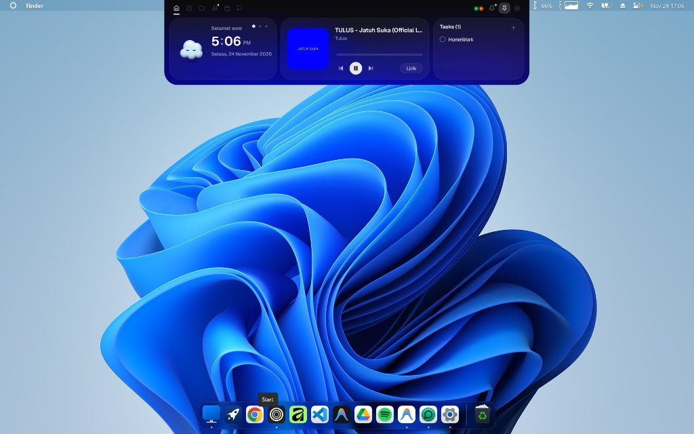
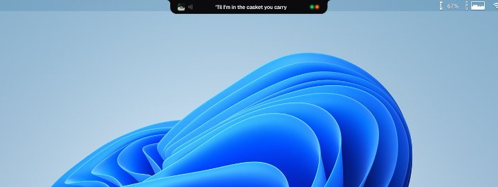
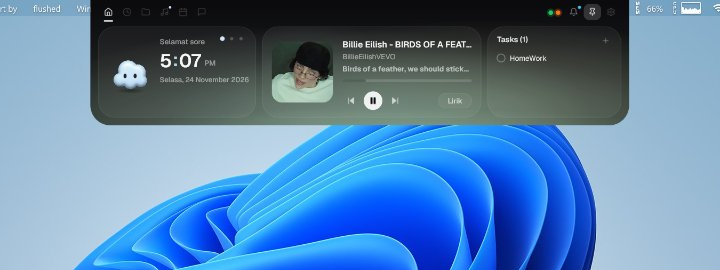
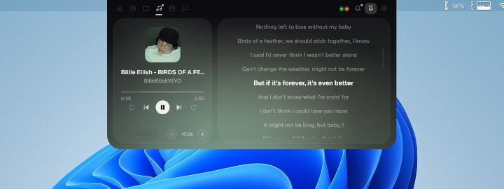
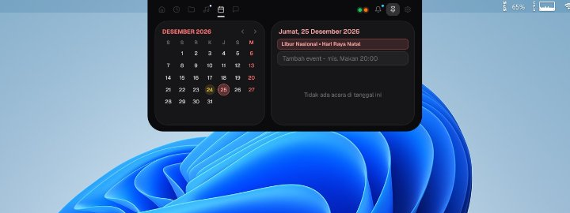
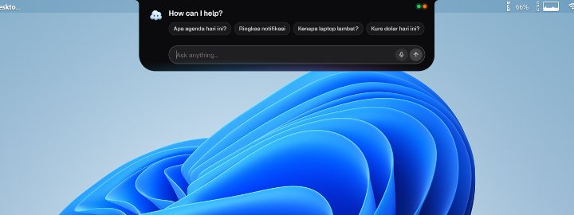
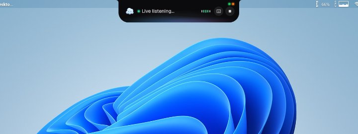

<p align="center">
  
</p>

<h1 align="center">SelaBar v0.2.0</h1>

<p align="center">
  <strong>Dynamic Notch &amp; Desktop AI Companion untuk Windows (Pure Rust + Direct2D)</strong>
</p>

<p align="center">
  
</p>

---

**SelaBar** adalah aplikasi Dynamic Notch native Windows yang ringan (~12 MB), responsif, dan bebas WebView. Proyek ini merupakan *fork* dan pengembangan lanjutan dari [**DeskNotch**](https://github.com/yashsrivasta7a/deskNotch) oleh **Bruh Labs** (`yashsrivasta7a`). Dibangun dengan Rust, Direct2D, dan Win32 API untuk menghadirkan asisten AI suara/teks, kontrol musik dengan lirik *real-time*, notifikasi pintar, rak file cepat, kalender Indonesia, serta sistem persetujuan aksi agen (*Approval Card*) langsung di bagian atas layar.

## Cuplikan Fitur Unggulan

| Notch Tertutup + Lirik Real-Time | Home Glance + Ambient Album Glow |
| :---: | :---: |
|  |  |
| **Music & Synced Lyrics** | **Kalender + Libur Nasional Indonesia** |
|  |  |
| **Ask AI (`Ctrl+Alt+C`)** | **Live Voice AI (`Ctrl+Alt+V`)** |
|  |  |

## Fitur Utama

### 1. Dynamic Notch Native, Installer & Auto-Update
- **Animasi Spring Mulus (Direct2D + Win32)**: Ukuran notch fleksibel (**Kecil / Normal / Besar**), *pin* agar tetap terbuka, serta *auto-tuck* otomatis saat aplikasi lain masuk mode fullscreen.
- **Installer Resmi + Auto-Update Bawaan**: Tersedia `SelaBar-v0.2.0-Setup.exe` (terdaftar rapi di *Windows Settings → Apps* untuk uninstall bersih + shortcut Start Menu & Desktop) serta pemeriksaan pembaruan langsung ke GitHub Releases di **Settings → General**.
- **Z-Order Anti-Overlap & Single-Instance Guard**: Tetap rapi di atas bilah atas maupun dock desktop (seperti *MyDockFinder*), serta mencegah aplikasi terbuka ganda saat diluncurkan ulang.
- **6 Tab Terintegrasi**:
  - **Home (Glance)**: Ringkasan jam, tanggal, status media/meeting, dan daftar tugas cepat.
  - **Clipboard & Files (Shelf)**: Rak drag-and-drop file sementara sekaligus riwayat clipboard teks dan gambar cepat.
  - **Music & Lyrics + Sound Output Switcher**: Kontrol media Windows (SMTC), lirik tersinkronisasi *real-time* (LRCLIB) dengan lebar notch dinamis menyesuaikan panjang lirik, **Ambient Album Art Glow**, serta panel **Sound Output & Volume** (klik ikon headphone) untuk mengganti perangkat playback (*Speakers*, *Earbuds*, *Bluetooth*) 1-klik.
  - **Calendar**: Kalender bulanan lengkap dengan penandaan hari Minggu serta tanggal merah **Hari Libur Nasional & Cuti Bersama Indonesia (2025–2027)** secara offline.
  - **Notifications (+ Klik Kanan DND)**: Pusat riwayat notifikasi Windows lengkap dengan tombol salin **OTP** 1-klik, balas cepat, serta mode *Do Not Disturb*.
  - **Chat AI (`Alt+C`)**: Antarmuka percakapan AI langsung dari notch dengan dukungan tempel gambar, file, maupun isi clipboard ala TUI.

### 2. Companion Interaktif & Focus Timer
- Maskot 3D interaktif yang bereaksi terhadap musik, aktivitas suara (partikel audio), dan **Focus Timer**.
- Mode **Auto Sleep** (otomatis tidur di atas jam 22:00 atau saat idle) serta opsi karakter dan jadwal yang dapat dikustomisasi di **Settings**.

### 3. Live Voice AI, Dikte Lokal (Whisper CPU/CUDA) & Edge Neural TTS
- **Shortcut Cepat**: `Ctrl+Alt+V` (**Live Voice AI**), `Ctrl+Alt+D` (**Dikte langsung ke kursor**), `Ctrl+Alt+C` (**Ask AI** popup cepat), dan `Esc` untuk membatalkan sesi AI/suara maupun menutup popup aktif secara bersih tanpa tumpang tindih.
- **Downloader Model Whisper Bawaan**: Jika model suara belum terpasang saat tombol mic/hotkey ditekan, popup langsung menawarkan pilihan ke **Chat** atau **Download** (**CPU ~190 MB** untuk semua PC atau **CUDA ~882 MB** untuk GPU NVIDIA). Semua aset tersimpan di `%APPDATA%\SelaBar\`.
- **Pure Rust Edge Neural TTS + Auto-Fallback Offline**: Suara neural alami (*Gadis / Ardi*) secara default saat online dengan tuning emosi/EQ, otomatis beralih ke suara offline Windows (*Andika*) jika tanpa internet, plus durasi tampil teks diperpanjang saat TTS dimatikan.

### 4. Multi-Provider AI (Auto-Fallback) & Optimasi AI Harness
- **Multi-Provider Endpoint (Konfigurasi Awal Bersih)**: Mendukung **Google Gemini (AI Studio API Key)**, **OpenAI-Compatible** (OpenAI, Groq, OpenRouter, dll.), serta **Local / Custom Router** (Ollama, `http://localhost` & `https://`) tanpa endpoint pribadi/bawaan yang terisi otomatis saat instalasi baru. Bila satu provider terkena *rate limit* atau error, SelaBar otomatis berpindah ke provider lain yang terisi.
- **Optimasi AI Harness (Browser Batch & Web Search Paralel)**: Otomasi halaman web/formulir/kuis mendukung pembacaan urutan visual (`@bN`), aksi *batch* + auto-scroll, serta pencarian web paralel (`web_search`, `web_fetch`, `weather`, `currency_rate`) langsung di latar belakang.
- **Mode Akses AI (`Auto` vs `Manual`)**: Dapat diatur di **Settings → General**:
  - **Auto**: Aksi aman/baca langsung berjalan dan hanya menampilkan kartu izin (*Approval Card*) untuk aksi penting atau berisiko.
  - **Manual**: Meminta persetujuan untuk setiap aksi AI.

### 5. Approval Card Multi-Provider & Antrean Cerdas
- **Integrasi Agen Eksternal via Named Pipe**: Menampilkan kartu izin aksi dari **OpenCode**, **ZCode**, maupun **SelaBar AI** lengkap dengan *badge* nama provider.
- **Antrean Anti-Tabrak**: Jika sesi **Voice AI** atau **Ask** sedang berlangsung, kartu persetujuan baru akan mengantre dan baru muncul setelah sesi suara selesai.

### 6. Notifikasi Pintar (WhatsApp Web, ZapFast & Panggilan Masuk)
- **Tinggi Popup Adaptif**: Ukuran kartu notifikasi otomatis menyesuaikan panjang pesan agar tombol aksi selalu proporsional dan nyaman diklik.
- **Routing Chat Langsung**: Klik notifikasi **ZapFast** langsung memfokuskan dan membuka obrolan tujuan (`Ctrl+K`) tanpa UIA; notifikasi **WhatsApp Web** langsung beralih ke tab browser yang tepat tanpa menumpuk tab baru.
- **Notifikasi Panggilan Masuk**: Menampilkan notifikasi panggilan masuk dengan tombol cepat **Buka** (langsung fokus ke jendela aplikasi/tab panggilan) dan **Tutup** — ringan dan tidak mengganggu alur panggilan.

### 7. Keamanan & Privasi
- **Penyimpanan API Key Terenkripsi (DPAPI)**: API Key dienkripsi memakai *Windows Data Protection API* per-pengguna (tidak tersimpan sebagai teks biasa di `store.json`), dengan penulisan konfigurasi secara atomik.
- **Validasi Aksi & Jaringan**: Memblokir akses ke IP privat/link-local pada fetch eksternal (anti-SSRF), protokol/LOLBin berbahaya, serta memvalidasi perintah shell *read-only* secara ketat.
- **Named Pipe Lokal**: Server named pipe hanya menerima koneksi lokal (`reject_remote_clients`) dengan batas ukuran payload.

---

## Cara Download & Menjalankan (GitHub Releases)

1. **Rekomendasi (Installer)**: Unduh **`SelaBar-v0.2.0-Setup.exe`** dari halaman [GitHub Releases](https://github.com/kyyyyraa/SelaBar/releases/latest) dan jalankan — otomatis memasang ke `%LOCALAPPDATA%\Programs\SelaBar`, membuat shortcut Start Menu & Desktop, serta terdaftar resmi di *Windows Settings → Apps* untuk uninstall bersih.
2. **Opsi Portabel**: Unduh **`SelaBar-v0.2.0-win64-portable.zip`** atau **`SelaBar.exe`** langsung.
3. *(Opsional)* Untuk mengaktifkan input suara offline (Whisper), tekan `Ctrl+Alt+V` lalu pilih **Download** → pilih versi **CPU (~190 MB)** atau **CUDA (~882 MB)**.
4. Buka **Settings → General** untuk mengisi Google Gemini (AI Studio API Key), endpoint OpenAI-Compatible, dan/atau Local Router milikmu, serta Mode Akses (**Auto / Manual**).

## Hotkey Default

| Shortcut | Fungsi |
| :--- | :--- |
| `Ctrl+Alt+V` | Live Voice AI |
| `Ctrl+Alt+D` | Dikte suara langsung ke aplikasi aktif |
| `Ctrl+Alt+C` | Ask AI (popup cepat) |
| `Alt+C` | Buka tab Chat AI |
| `Esc` | Hentikan AI / Voice atau tutup popup aktif |

*(Semua shortcut bisa diubah langsung di **Settings → Voice → Global Hotkeys**).*

## Build dari Source (Windows)

Prasyarat: Rust toolchain stabil + Windows 10/11 SDK (`rc.exe`).

```powershell
# Jalankan unit test
cargo test -- --skip resolves_whisper_cuda_and_model_locally

# Build binary release (otomatis menyematkan icon.ico & metadata v0.2.0)
cargo build --release --bin SelaBar

# Kemas aset rilis ke folder dist\
powershell -ExecutionPolicy Bypass -File .\scripts\package-release.ps1 -SkipBuild
```

## Kredit, Asal Proyek & Lisensi

- **Proyek Asal**: SelaBar merupakan *fork* yang dimodifikasi dan dikembangkan dari [**DeskNotch**](https://github.com/yashsrivasta7a/deskNotch) (*DeskNotch by Bruh Labs*, [`yashsrivasta7a`](https://github.com/yashsrivasta7a)).
- **Izin Resmi & Kontribusi**: Dikembangkan setelah mendapatkan izin resmi pada [**Issue #9 — Permission to fork and modify DeskNotch**](https://github.com/yashsrivasta7a/deskNotch/issues/9).
- **Lisensi**: Dirilis di bawah [**MIT License**](LICENSE), dengan tetap mempertahankan pemberitahuan hak cipta asli (`Copyright (c) 2026 Devezio`).
